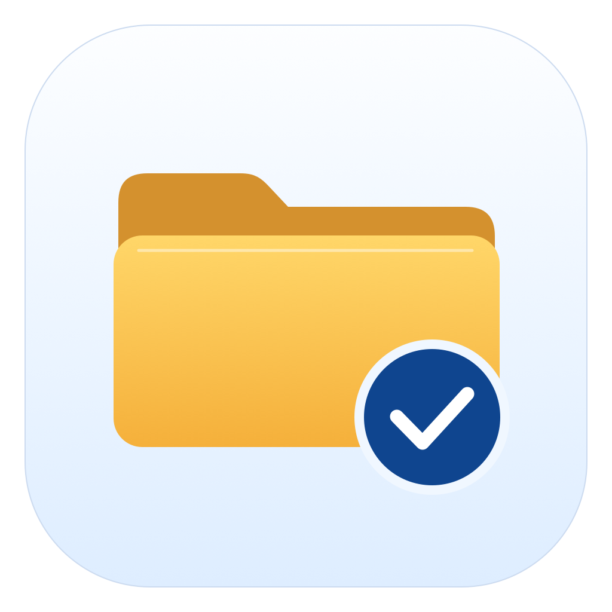

# Folder Backup



**Free, open-source folder backups for macOS.** Select the folders that matter,
save incremental versions to a drive you control, and restore a complete version
or just the files you need.

[한국어 안내](README.ko.md) · [Download](https://github.com/LeSIK-Office/folder-backup/releases)
· [Architecture](docs/ARCHITECTURE.md) · [License and provenance](docs/LEGAL.md)

| Item | Current release |
|---|---|
| Version | **1.5.1 beta 1**, app build **16**, tag `v1.5.1-beta.1` |
| Platform | macOS **14.0+**, native SwiftUI/AppKit app |
| Architectures | Universal: Apple Silicon `arm64` and Intel `x86_64` |
| Price | Free; no subscription, account, advertising or paid feature tier |
| License | [MIT](LICENSE), including commercial use and modification |
| Distribution | GitHub prerelease; **ad-hoc signed, not Apple notarized** |

This is a beta. Apple Silicon execution has been tested locally; Intel hardware
and the oldest supported macOS have not. Read the [validation scope](docs/VALIDATION-SUMMARY.md)
before relying on this as your only copy of important data.

## Why Folder Backup?

Back up a project, documents or selected directories without a full-system image,
a cloud account or two-way synchronization.

- **Folder-level plans:** one or more existing folders and a destination per plan.
- **Incremental storage:** unchanged contents are shared across versions within
  the same plan; new or changed contents are stored as needed.
- **Versioned recovery:** browse dated backups, search file lists, and restore a
  whole version or selected folders/files into a new folder.
- **Resume:** copied data survives interrupted backups and is checked for reuse
  on the next attempt. Incomplete runs are not presented as completed backups.
- **Schedules:** manual, continuous, hourly, daily, weekly and monthly.
- **Retention:** all versions, latest only, or most recent N; individual saved
  versions can also be moved to Trash.
- **Clear storage information:** dates, file counts, logical restore size, newly
  stored contents and actual plan disk usage are shown separately.
- **Integrity and metadata:** SHA-256 checks, hidden files, empty directories,
  symbolic links, permissions and extended metadata handling.
- **Small-file packing:** system SQLite packs small contents on exFAT to reduce
  allocation waste on drives with large allocation units.
- **Menu bar residence:** schedules continue after closing the window, with
  optional launch at login.
- **Five built-in languages**, automatic selection and manual override.

No particular drive brand is required. Use a writable destination macOS can
access. APFS and exFAT have been exercised directly; NAS/network-volume reliability
and every filesystem combination have not been established.

## Download and install

1. Open [Releases](https://github.com/LeSIK-Office/folder-backup/releases), select
   **`v1.5.1-beta.1`**, and download `FolderBackup-1.5.1-beta.1-universal.zip`.
   GitHub's **Source code** archives contain source, not an installed app.
2. Optionally download `SHA256SUMS` and compare the app ZIP's hash:

   ```sh
   shasum -a 256 FolderBackup-1.5.1-beta.1-universal.zip
   ```

   This checks file consistency; it does not replace Apple signing or notarization.
3. Unzip and drag **Folder Backup.app** into **Applications**, then open it there.
4. This beta is not notarized, so macOS may block the first launch. If you trust
   the download, review the app-specific **System Settings → Privacy & Security →
   Open Anyway** option, following [Apple's instructions](https://support.apple.com/en-us/102445).
   Availability depends on macOS and device-management policy. Do not disable
   Gatekeeper globally. Stop if macOS reports detected malware.
5. Approve access to the folders and removable drives you intend to use. Protected
   folders or managed Macs may require permission changes by their owner/admin.

No Apple developer membership, package manager or separate runtime is needed to
use the downloaded app. A downloaded copy on a different Mac has not yet been verified.

## First backup and restore

1. Click **New Backup**, name the plan and select source folders.
2. Choose the destination, preferably on a different physical drive. Source and
   destination cannot contain one another; source folders cannot overlap. The
   app does not format your drive.
3. Configure schedule, retention and exclusions in **Settings**.
4. Click **Back Up Now**. The initial scan/copy can take time. Wait for a completed
   entry under **Saved Backups**.
5. Open **Restore** or **Restore & History**, choose a version and optional files,
   then a restore location. Restoring creates a new folder. The original-location
   option also creates a separate restored folder beside the source, preserving
   existing files.

If backup stops or fails, reconnect the intended drive, resolve the displayed
cause and use **Resume Backup**. Reusable copies remain available. An interrupted
restore may leave a hidden partial folder; retry creates a fresh output instead
of treating the partial folder as complete.

## Incremental versions and disk usage

A saved version is a **complete catalog of that run**, referencing shared file
contents. It is not a separate full disk-image file or a sequence you must apply
one step at a time. Preserve the **whole plan directory**; a dated folder alone
is insufficient for recovery.

Example: 50 GB of initial unique contents + 1 GB of new unique contents + 2 GB on
the third run needs roughly **53 GB of content**, plus catalogs, metadata,
filesystem allocation and retained Trash data. Three versions do not automatically
mean 150 GB. If all 50 GB changes to different content each time, usage can approach
150 GB. This is **whole-file deduplication**, not block-level deltas or compression;
editing a large file can store another full copy of that file.

Deleting a source file omits it from the next completed version. Older retained
versions can still restore it. Old content is reclaimable only when no retained
version needs it. Retention runs after a successful backup and preserves shared
data required by remaining versions. Data moved to Trash continues using space
until Trash is emptied.

**Restore size** is the logical size at a selected point. Do not add these sizes
to calculate physical storage. **Actual disk usage** is the plan store's allocated
size, including catalogs/shared contents, not the drive's total usage or unrelated
restored test folders.

## Schedules and background operation

The app must be running, the Mac awake and the intended destination connected.
Closing the window or using the Dock quit action keeps the menu bar app resident.
**Quit Completely** stops scheduling. Enable **Settings → App → Launch Folder
Backup at Login** if desired. Missed schedules are checked when the app runs again
and the destination is available. It does not wake a sleeping or shut-down Mac.

Continuous mode polls for changes at roughly one-minute intervals; it is not an
instant filesystem-event mirror. Monthly schedules use the last day of a short
month when the selected day does not exist. Large trees still require scanning
even when little new content needs storing.

## Languages

English, 한국어, 日本語, 简体中文 and Español ship inside the app. There is no
language-pack download. **System language** is the default and follows the Mac's
primary language, not its country/region. Korean selects Korean, Japanese selects
Japanese; unsupported languages such as Vietnamese or French select English.
Chinese locales currently use Simplified Chinese; Traditional Chinese is not included.

Override this in **Settings → App → Language**. App text changes immediately;
native macOS menus/dialogs may need a restart. Product names, user plan names,
filenames and paths are preserved. Translations were written for each UI context;
independent native-speaker review is welcome. [Language details](docs/LOCALIZATION.md).

## Build and test

Requirements: macOS, Apple Command Line Tools or Xcode with **Swift 6+**, a macOS
SDK, Python 3 and zsh. There are no third-party Swift package dependencies.

```sh
git clone https://github.com/LeSIK-Office/folder-backup.git
cd folder-backup
zsh scripts/build.sh
```

Output: `dist/Folder Backup.app`, both architectures, ad-hoc signed by default.
Version/build are defined in `Resources/Info.plist`. The published build used
Swift 6.2.3 on Apple Silicon with macOS 27.0.1. The deployment minimum is macOS 14;
this is not a claim of testing every supported OS release.

```sh
swift run -c release BackupCoreChecks    # Core backup/restore checks
zsh scripts/check-runtime.sh            # Scheduling and app lifecycle
zsh scripts/check-release.sh            # Includes disk-image fault tests
zsh scripts/package-release.sh          # Package a previously built app
```

The full preflight needs several GB of free space. Disconnect/full-disk tests
operate on an owned test image, not a physical backup drive. Test artifacts are
retained. Packaging checks a runtime-source manifest and exports allowlisted
source without local Git history, private evidence or backup data.
See [architecture / 구성](docs/ARCHITECTURE.md) and [release procedure](docs/RELEASE.md).

Validation includes 17 core workflows, interrupted backups/restores, full-storage,
disconnect and corruption fixtures, direct exFAT incremental/retention checks,
and a complete real-backup restore: **453,024 regular files / 49,796,768,925 bytes,
every SHA-256 matched**. These are recorded tests, not guarantees for every device
or failure. [Detailed scope and gaps](docs/VALIDATION-SUMMARY.md).

## Limits, privacy and legal information

- Folder backup only: no full-system recovery, disk imaging, mirroring, cloud
  backup, encryption, compression or automatic app updater.
- Files can change during backup. Changes are retried, runtime sockets/pipes are
  skipped and disappearing items are reported. This is not an atomic APFS snapshot
  or an application-aware database backup.
- No account, telemetry, analytics or developer-operated upload service. Anyone
  with suitable storage access can read backup names/contents. [Privacy](PRIVACY.md),
  [개인정보 처리](PRIVACY.ko.md).
- Independent project, not affiliated with Seagate, LaCie or Apple. **REA (Reverse Engineer Anything)** was used to study Toolkit features and
  workflows as references. **The original program’s code was not copied; the app
  was implemented separately in Swift**, with its own storage format. It does
  **not** import or restore Seagate Toolkit backup archives.
- [MIT](LICENSE) applies to this project's original code/artwork, not third-party
  trademarks, Apple SDKs or referenced vendor materials. Read [provenance and legal
  boundaries](docs/LEGAL.md) and [third-party notices](THIRD_PARTY_NOTICES.md).
  No blanket legal clearance is claimed.

## Feedback and contributions

Open an [issue](https://github.com/LeSIK-Office/folder-backup/issues) with app/build
and macOS versions, filesystem, reproduction steps and redacted error text.
Do not upload your backup store, source files, access bookmarks or private paths.
For changes, explain behavior and relevant tests in a pull request. Contributions
must be your own or appropriately licensed and MIT-compatible; do not submit
vendor binaries or extracted artwork.
